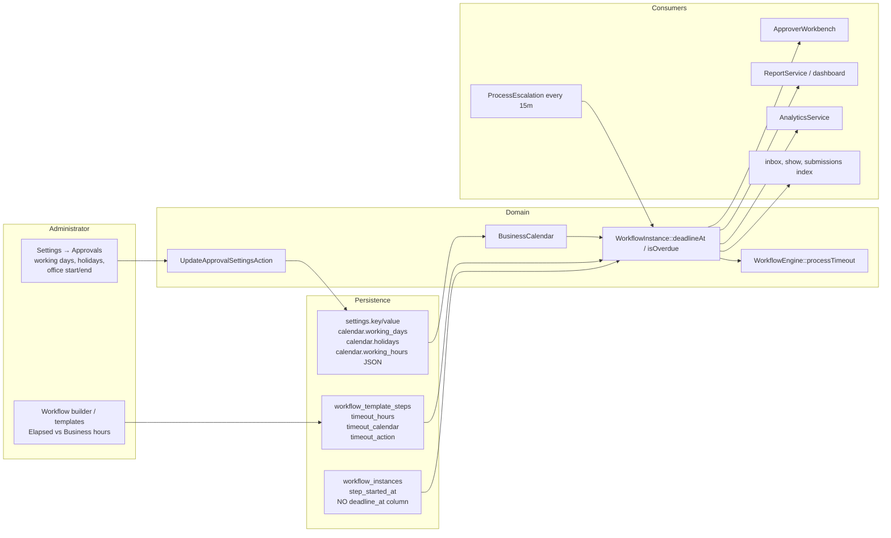
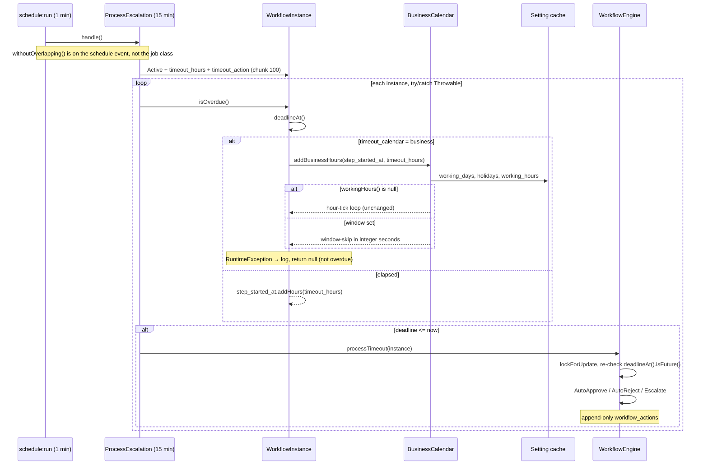
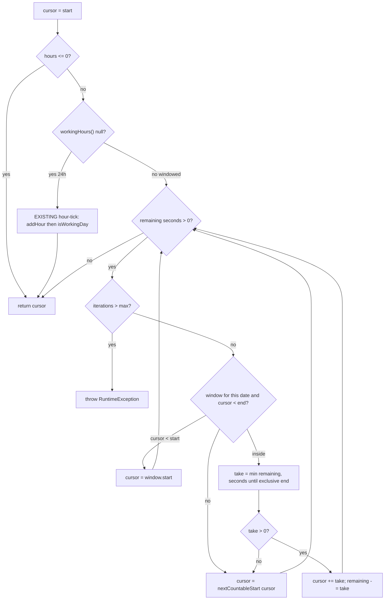

# Organization working / office hours for ApproveDesk business-hour SLAs

| Field | Value |
|---|---|
| **Document** | Phase 7B design — organization working / office hours |
| **Author** | ApproveDesk architecture (draft for implementation) |
| **Date** | 2026-08-20 |
| **Status** | Draft |
| **Version** | v2.3.2 (Phase 7B) |
| **Canonical plan** | `IMPLEMENTATION_PLAN.md` |
| **Related ADR** | `docs/adr/0001-organization-working-hours.md` (to be added; first ADR) |

---

## Overview

Workflow steps can already choose **Deadline calendar = Elapsed hours** or **Business hours** (`App\Enums\TimeoutCalendar`). Today “Business hours” is a misnomer: `App\Services\Workflow\BusinessCalendar` only skips non-working weekdays and holidays. Every hour of a working calendar day (00:00–23:59 in `config('app.timezone')`, currently UTC) counts toward the SLA. Administrators configure working days and holidays on **Settings → Approval settings** (`resources/views/pages/settings/approvals.blade.php`) but have no office-hour window.

Phase **7B** extends the existing org-wide business calendar with optional office hours stored as a JSON settings key (`calendar.working_hours`). When hours are set, a Business-hour instant counts only inside a half-open `[start, end)` window on a working, non-holiday weekday, added with a **window-skipping** algorithm over integer seconds. When hours are unset or empty, `addBusinessHours()` keeps **today’s hour-tick loop unchanged** (`addHour()` then count if the destination is a working calendar day) so in-flight Business SLAs do not silently shrink. Elapsed hours remain wall-clock. Deadlines stay **live-computed** in `WorkflowInstance::deadlineAt()`; we do not snapshot `deadline_at` and we do not mutate `workflow_actions`. Production list mappers and `ProcessEscalation` never see a calendar exception: `deadlineAt()` fails open to `null` (not overdue) if the windowed path cannot consume remaining time.

This phase is additive. It sits after Phase 7A (complete) and before Phase 8 (not started). Phases 0–7A task IDs and Complete status stay untouched. Phase 6 stays **In progress**. Phase 8+ IDs (`P8-COL-03`, `P8-COL-04`, `P8-COL-05`, `P8-NOT-04`, `P10-TEN-01`) and `P7-RTE-03` are not reopened.

---

## Background & Motivation

### Current state

| Piece | Behaviour today |
|---|---|
| Settings UI | Working days (ISO 1–7 checkboxes) and holidays (`YYYY-MM-DD` textarea). No start/end time. |
| Persistence | `Setting::put('calendar.working_days', …)` and `calendar.holidays` via `UpdateApprovalSettingsAction`. Key/value `settings` table, cached forever per key. |
| Calendar | `BusinessCalendar::isWorking()` = weekday ∈ working days AND date ∉ holidays. `addBusinessHours()` loops `$cursor->addHour()` and decrements when `isWorking($cursor)`. |
| Deadlines | `WorkflowInstance::deadlineAt()`: Business → `addBusinessHours($step_started_at, $timeout_hours)`; else `$step_started_at->addHours($hours)`. **Not stored.** |
| Overdue | `isOverdue()` compares live `deadlineAt()` to `now()`. Consumed by the workbench, dashboard, submission lists, analytics, and `ProcessEscalation` (every 15 minutes). |
| Templates | `timeout_calendar` is `elapsed` \| `business`. Builder/template selects “Elapsed hours” / “Business hours”. Schema hash includes `timeout_calendar`. |
| Tests | `DynamicRoutingTest::test_business_calendar_skips_weekend`: Thu 2026-12-24 09:00 + 24 business hours, holiday 2026-12-25, Mon–Fri → date `2026-12-28`. |
| Help | “Business hours skip non-working days and holidays.” No office hours. |

Relevant code:

```64:86:app/Models/WorkflowInstance.php
    public function deadlineAt(): ?CarbonInterface
    {
        $hours = $this->currentStep?->timeout_hours;

        if ($hours === null || $this->step_started_at === null) {
            return null;
        }

        if ($this->currentStep->timeoutCalendar() === TimeoutCalendar::Business) {
            return app(BusinessCalendar::class)->addBusinessHours($this->step_started_at, $hours);
        }

        return $this->step_started_at->addHours($hours);
    }

    public function isOverdue(): bool
    {
        $deadline = $this->deadlineAt();

        return $this->status === WorkflowStatus::Active
            && $deadline !== null
            && $deadline->lessThanOrEqualTo(now());
    }
```

```43:65:app/Services/Workflow/BusinessCalendar.php
    public function isWorking(CarbonInterface $instant): bool
    {
        if (! in_array((int) $instant->isoWeekday(), $this->workingDays(), true)) {
            return false;
        }

        return ! in_array($instant->toDateString(), $this->holidays(), true);
    }

    public function addBusinessHours(CarbonInterface $start, int $hours): CarbonImmutable
    {
        $cursor = CarbonImmutable::parse($start);
        $remaining = max(0, $hours);

        while ($remaining > 0) {
            $cursor = $cursor->addHour();
            if ($this->isWorking($cursor)) {
                $remaining--;
            }
        }

        return $cursor;
    }
```

### Pain points

1. Operators reasonably expect “Business hours” + 8-hour SLA starting Monday 09:00 to fall due Monday 17:00, not Tuesday 09:00.
2. A step that starts Monday 16:00 with an 8-hour Business SLA currently expires Tuesday 00:00. With a 09:00–17:00 office, it should expire Tuesday 16:00.
3. Overnight and weekend wall-clock hours currently burn Business SLAs on working days. That is not how office SLAs are sold or understood.
4. A naive **minute** loop on every workbench/analytics row is unacceptable at template max **8760 hours** (up to ~5.26×10⁵ iterations per row). Today’s **hour-tick** loop is already production behaviour for unset hours and is **kept**. Window-skipping is the windowed path only.

### Why this phase, and why not later ones

Phase 7 already shipped business-calendar-aware deadlines (`P7-RTE-03 — Complete`). The calendar object and `TimeoutCalendar::Business` case exist. 7B *extends* that calendar; it does not reopen 7.3, does not add a third enum, and does not touch frozen published graphs.

Quiet hours, OOO, estimated-due UI, and org timezone are already assigned to Phase 8 and Phase 10. Stealing them would scramble the canonical plan.

---

## Goals & Non-Goals

### Goals

- True office/working hours for steps whose `timeout_calendar` is `business`.
- One organization, one calendar. Hours live next to working days and holidays.
- Additive Phase 7B (v2.3.2) that does not disturb completed or future phases.
- Unset hours ⇒ **bit-for-bit today’s hour-tick Business behaviour**, including `test_business_calendar_skips_weekend` (date **and** time `09:00:00` on the canary).
- Elapsed-hour SLAs and email approval link expiry (`approvals.email_link_expiration_hours`, 1–720 wall-clock hours) unchanged.
- Shared-hosting safe: no Redis, no new daemon, SQLite-testable, no MySQL `ENUM`, settings cache as today.
- Windowed `addBusinessHours` fast enough for list pages and the 15-minute escalation job at max SLA (8760 hours).
- Calendar failures never 500 the inbox or abort `ProcessEscalation` mid-chunk.
- `WorkflowEngine` coverage remains 100%. Calendar logic stays out of the engine. `workflow_actions` stays append-only.

### Non-goals

- Per-user working hours or per-approver calendars.
- Out-of-office schedules, future delegation, fallback approvers (`P8-COL-04`).
- Nudge quiet-hour handling (`P8-COL-03`) and notification quiet hours (`P8-NOT-04`).
- Requester-visible estimated due time (`P8-COL-05`) — it may *consume* this calendar later.
- Organization timezone (`P10-TEN-01`). Hours are in `config('app.timezone')` (hardcoded `UTC` in `config/app.php` today).
- Overnight shifts (`start >= end`), 24:00 as an end token, multiple named calendars, per-step custom hours.
- Changing email-link expiry to business hours.
- Snapshotting `deadline_at` onto `workflow_instances` or writing due times into `workflow_actions`.
- A third `TimeoutCalendar` case or a published-graph schema change (`WorkflowTemplateSchemaHasher` must keep hashing the same fields).
- Feature flag (see Key Decisions).
- Requiring a minimum window length of 1 hour (any `start < end` in `HH:MM` is valid, including `09:00–09:01`).

---

## Key Decisions

| Decision | Choice | Rationale |
|---|---|---|
| **Scope of hours** | Org-wide on the existing `BusinessCalendar`, not per-user and not per-step | Single-org v2; per-user OOO is Phase 8; per-step hours would fork policy and frozen versions |
| **Storage** | New `settings` key `calendar.working_hours` (JSON text). No table, no migration | Matches `calendar.working_days` / `calendar.holidays`; `by_day` can be added later without a migration |
| **Default** | Unset/empty = 24 hours on working days. **Do not** backfill 09:00–17:00 | `deadlineAt()` is live; a default window would immediately shrink every in-flight Business SLA |
| **24h algorithm** | **Keep the existing `addHour()` tick loop** when `workingHours()` is `null` | The only way to guarantee production SLAs do not change until an admin saves hours. Window-skipping a 24h day is **not** tick-equivalent (weekend starts, holiday midnights) |
| **Windowed algorithm** | Window-skipping over **integer seconds** (`hours * 3600`). `take > 0` or jump strictly forward | Avoids minute-loops of 8760h SLAs; exclusive-end remainders must not livelock; `diffInMinutes` truncation is forbidden |
| **Window** | Half-open `[start, end)` in app timezone; `start < end` required; no minimum length | 09:00–17:00 = 8 hours; 17:00 is not a counting instant; overnight deferred; `09:00–09:01` is legal |
| **24-hour sentinel** | Missing/empty/invalid **top-level** `start`/`end` only. Not `00:00–00:00` (fails `start < end`). Not `00:00–23:59` (that is 23h59m) | One obvious empty state in the UI |
| **Live calendar** | Keep computing from `step_started_at` + current settings | Same as today’s working days/holidays; changing hours immediately affects in-flight Business overdue/escalation |
| **Safety cap** | Two **independent** budgets. Outer `addBusinessHours` loop: `max(10_000, $hours * 60 * 7 + 366)` iterations (each consume or each `nextCountableStart` **call**). `nextCountableStart` date walk: **4000 calendar days per call**, never deducted from the outer counter | Sharing one counter false-positives on a legal 1-minute window (inner walk days + outer consume ≈ 4.2e6 > 3.68e6). Per-call 4000 days covers `holidays` max (~450 dates) plus weekends and fails closed on the empty-`workingDaysOverride` seam |
| **Consumer isolation** | `addBusinessHours` may throw; `deadlineAt()` catches and returns `null`; `ProcessEscalation` try/catches per instance | A hung or throwing calendar must not 500 the inbox or skip later elapsed instances in the same chunk |
| **`by_day`** | In the JSON schema and honored by `BusinessCalendar`; **not** in the 7B UI | Future per-weekday UI does not reopen 7B; screen stays two time inputs |
| **Enum / schema** | No third calendar. Help-text only on builder/templates | Published graphs and `WorkflowTemplateSchemaHasher` stay valid |
| **Feature flag** | None | 7A shipped without one; unset hours preserve production SLAs, so a flag adds owner/removal/tests without protecting anyone. Plan §3.1 flags are for *partially built* features; PR 1 is behaviour-preserving |
| **Engine** | No `WorkflowEngine` changes; no `workflow_actions` writes | Timeouts already go through `deadlineAt()` → `processTimeout()` |
| **Timezone** | `config('app.timezone')` (UTC). `setTime`, never `addHours(24)` | `P10-TEN-01` owns org timezone; ADR pins the DST landmine now |
| **Action contract** | `null`+`null` leave unchanged; `''`+`''` clear; both `H:i` put; one set throw | Livewire always passes the pair; future `execute($hours, $days, $holidays)` callers must not wipe office hours |
| **Analytics eager-load** | Add `timeout_calendar` to `AnalyticsService`’s constrained `currentStep` select | Today the constrained load omits `timeout_calendar`, so `timeoutCalendar()` falls back to Elapsed and analytics overdue is wrong for Business steps — a latent P7-RTE-03 bug 7B must close |

---

## Proposed Design

### Architecture



Calendar policy is organization settings. Step policy is only “which clock”: Elapsed vs Business. The engine never sees office hours directly.

### Semantics

Let `W` be ISO weekdays in `calendar.working_days` (default `1,2,3,4,5`). Let `H` be holiday dates in `calendar.holidays`. Let `hours` be the optional JSON window.

An instant `t` **counts as a Business-hour instant** (`isWorking`) iff:

1. `(int) $t->isoWeekday()` ∈ `W`, and
2. `$t->toDateString()` ∉ `H`, and
3. either hours are unset (24-hour working day — same as today’s `isWorking`), or local time-of-day of `t` is in `[start, end)` for that weekday.

`isWorkingDay($t)` is (1) and (2) only. Jump logic uses `isWorkingDay`. Today’s sole caller of `isWorking()` is `BusinessCalendar` itself; the rename of meaning to “counts toward SLA” is safe.

**Elapsed hours:** ignore `W`, `H`, and office hours. `$step_started_at->addHours($hours)` as today.

**Email approval links:** `ApprovalLinks::expirationHours()` remains elapsed wall-clock (1–720). Different clock, different setting.

**Half-open window:** `[09:00, 17:00)` is 8 hours = 28 800 seconds. `17:00:00` is **not** a counting instant (`isWorking` false) but **may** be returned as a deadline (Monday 09:00:00 + 8h → Monday 17:00:00). `isOverdue()` compares the deadline, not `isWorking(now())`.

**Per-weekday override:** look up `by_day[(string) $isoWeekday]` (JSON keys are strings `"1"`…`"7"`). Friday override `{"5":{"start":"09:00","end":"13:00"}}` uses that window; other working days use default `start`/`end`. Days not in `W` remain non-working even if `by_day` lists them.

**Timezone:** Carbon instants are interpreted in `config('app.timezone')` (UTC). Do not convert to a browser or user timezone in 7B. Construct clock times with `setTime($h, $m, $s)` on that calendar date. Never `addHours(24)` to roll a date (DST-missing midnights in Phase 10).

**Live calendar:** changing office hours, working days, or holidays immediately changes `deadlineAt()`, overdue badges, workbench sort, analytics overdue counts, and whether `ProcessEscalation` fires. This is already true for days/holidays; Help must say so for hours as well.

### Data flow — overdue and escalation



Workbench and analytics call the same `deadlineAt()` / `isOverdue()` path. Livewire must not compute deadlines. `ApproverWorkbench::itemsFor` already calls `deadlineAt()` to fill `deadline` **and** `isOverdue()` which calls it again; `deadlineAt()` may memoize the result on the in-memory model for the rest of the request (optional, not required for correctness).

### Storage: `calendar.working_hours`

No schema migration. `settings.value` is already `text` nullable (`database/migrations/2026_08_16_231900_create_settings_table.php`). Definition of done for this task: **explicit statement that no schema change is required.** `Setting::put` already `Cache::forget("settings.{$key}")`. `Setting::get` uses `?? $default`, so a stored `null` after clear becomes the default (`''` if we pass `''`) — 24h mode.

JSON document (write shape):

```json
{
  "start": "09:00",
  "end": "17:00",
  "by_day": {
    "5": { "start": "09:00", "end": "13:00" }
  }
}
```

`by_day` is omitted on write when empty. Extra top-level keys are ignored on read.

**Do not insert a row in a seeder or migration.** There is no `SettingsSeeder` calendar backfill. Existing installs and tests stay on 24-hour mode until an administrator saves hours.

**A 24-hour working day is empty fields / missing key only.** `00:00–23:59` is 23 hours 59 minutes (`[00:00, 23:59)`). `00:00–00:00` fails `start < end` and is rejected on write. Help and the settings description must say this.

#### Parser spec (`BusinessCalendar::workingHours(): ?array`)

Let `TIME_RE` = `^([01]\d|2[0-3]):[0-5]\d$`.

**Normalize a time string** (read and write):

1. Trim whitespace.
2. If the value matches `^([01]\d|2[0-3]):[0-5]\d:[0-5]\d$`, drop the seconds (`09:00:00` and `09:00:30` both become `09:00` — windows are minute-resolution; `step_started_at` seconds are **not** stored in the JSON).
3. The result must match `TIME_RE`. `"9:00"` is invalid. `"24:00"` is invalid.

**Return `null` (24h mode, hour-tick path)** when any of:

- key absent, value `null`, `''`, `'null'`, or `'[]'` / `'{}'` without both top-level `start` and `end`
- `json_decode` fails or does not yield an associative array
- top-level `start` or `end` missing, not a string, or fails normalize+`TIME_RE`
- normalized top-level `start >= end`

On every 24h fallback caused by **present but invalid** JSON, `Log::warning` with key `calendar.working_hours` (not the raw blob if `strlen > 500`). Do not throw.

**When top-level `start`/`end` are valid:**

- Extra top-level keys ignored.
- `by_day` missing or not an object → treat as `[]`; **keep** the default window.
- For each `by_day` entry:
  - key must be exactly `"1"`…`"7"` (string). Unknown keys skipped.
  - value must be an object with `start` and `end` that normalize and satisfy `start < end`. Invalid entries **skipped** (`Log::warning` once per bad key). **Do not** revert the whole setting to 24h because one Friday override is corrupt.
- Lookup: `$byDay[(string) $instant->isoWeekday()] ?? default`. PHP `json_decode` yields string keys; never index with a bare `int` 5.

Return type for implementers (normalized):

```php
/**
 * @return array{
 *     start: string,
 *     end: string,
 *     by_day: array<string, array{start: string, end: string}>
 * }|null
 */
```

#### Write spec (`UpdateApprovalSettingsAction`)

- Encode with `JSON_THROW_ON_ERROR`. Keys `start`/`end` as normalized `H:i`. Include `by_day` only if the merged map is non-empty.
- Merge: load existing parse (if `workingHours()` is non-null, keep its `by_day`; if existing JSON is corrupt, `by_day` is `[]`).
- Max length of the encoded payload: **2000** bytes. `by_day` has at most 7 entries so this is ample. If a pre-seeded blob is huge, sanitize `by_day` to valid `"1"`…`"7"` entries only; if still `> 2000`, drop `by_day` and `Log::warning`, still persist `start`/`end`.
- Clear: `Setting::put('calendar.working_hours', null)` wipes `by_day`.

### `BusinessCalendar` API

Keep the class in `app/Services/Workflow/BusinessCalendar.php`.

```php
final class BusinessCalendar
{
    /**
     * Optional constructor overrides are a unit-test seam only.
     * The container resolves `new BusinessCalendar()` with no args.
     * An empty array override means "no working days" (does not fall back to Mon–Fri).
     *
     * @param  list<int>|null  $workingDaysOverride
     * @param  list<string>|null  $holidaysOverride
     * @param  array{start: string, end: string, by_day?: array<string, array{start: string, end: string}>}|null  $workingHoursOverride
     *         Pass null to read settings. Pass [] to force 24h mode in tests.
     */
    public function __construct(
        private readonly ?array $workingDaysOverride = null,
        private readonly ?array $holidaysOverride = null,
        private readonly ?array $workingHoursOverride = null,
    ) {}

    /** @return list<int> ISO-8601 weekdays (1 = Monday … 7 = Sunday) */
    public function workingDays(): array { /* settings parse; default Mon–Fri ONLY when override is null */ }

    /** @return list<string> Y-m-d */
    public function holidays(): array { /* unchanged parse, or override */ }

    /**
     * @return array{start: string, end: string, by_day: array<string, array{start: string, end: string}>}|null
     */
    public function workingHours(): ?array { /* parser spec above */ }

    /** Weekday ∈ working days and date ∉ holidays. Ignores office hours. */
    public function isWorkingDay(CarbonInterface $instant): bool { /* … */ }

    /**
     * Counts toward a Business-hour SLA.
     * Working day, and (24h mode or time ∈ [start, end) for that weekday).
     */
    public function isWorking(CarbonInterface $instant): bool { /* … */ }

    /**
     * Next SLA-countable interval start strictly after $cursor.
     * Windowed: next window.start on a working day.
     * 24h: not used by addBusinessHours (hour-tick path).
     */
    public function nextCountableStart(CarbonImmutable $cursor): CarbonImmutable { /* … */ }

    public function addBusinessHours(CarbonInterface $start, int $hours): CarbonImmutable { /* hybrid */ }
}
```

Parse `workingHours()` once per `addBusinessHours` call. Do **not** bind a request-lifetime singleton that memoizes across `Setting::put`: `pages::settings.approvals` already resolves `BusinessCalendar` in `mount()`, and a later `deadlineAt()` in the same request must see the write. `Setting::get` is already `Cache::rememberForever`.

### Hybrid `addBusinessHours`

Public API stays `int $hours` (`timeout_hours` is `unsignedSmallInteger`, UI max 8760). App dates are `CarbonImmutable` (`Date::use(CarbonImmutable::class)`); every step reassigns `$cursor = $cursor->…`.

```
addBusinessHours(start, hours):
  cursor = CarbonImmutable::parse($start, config('app.timezone'))
  hours = max(0, hours)
  if hours === 0: return cursor

  if workingHours() is null:          # 24h mode — EXISTING LOOP, do not "improve"
      remaining = hours               # whole hours, not seconds
      while remaining > 0:
          cursor = cursor.addHour()   # tick first, then test destination
          if isWorkingDay(cursor):    # same predicate as today's isWorking
              remaining -= 1
      return cursor

  # Windowed mode only from here
  remaining = hours * 3600            # integer seconds
  iterations = 0
  maxOuterIterations = max(10_000, hours * 60 * 7 + 366)
  # Do NOT share this counter with nextCountableStart (see that helper's own date-walk budget).

  while remaining > 0:
      iterations += 1
      if iterations > maxOuterIterations:
          throw RuntimeException('Business calendar could not consume remaining seconds')

      window = windowOnDate(cursor)   # null if !isWorkingDay(cursor)
      if window is null or cursor >= window.end:
          cursor = nextCountableStart(cursor)   # strictly later; own date-walk budget
          continue
      if cursor < window.start:
          cursor = window.start                 # setTime on that date; if not later, nextCountableStart
          continue

      # cursor ∈ [window.start, window.end)
      take = min(remaining, (int) window.end.timestamp - (int) cursor.timestamp)
      if take <= 0:
          cursor = nextCountableStart(cursor)   # never spin
          continue
      cursor = cursor.addSeconds(take)
      remaining -= take

  return cursor
```



#### Why 24h mode must not window-skip

Today’s loop **always `addHour()` first**, then decrements only when the **destination** is a working calendar day.

| Start | Hours | Holiday | Old hour-tick | Naive 24h window-skip | Production impact if we “unified” |
|---|---|---|---|---|---|
| Sat 09:00 | 8 | none | first counted tick Mon 00:00 … **Mon 07:00** | jump Mon 00:00 then consume 8h → **Mon 08:00** | `initialize()` on a weekend start is legal |
| Thu 09:00 | 15 | Fri | 14 Thursday ticks (10:00–23:00), skip Fri 00:00, **Mon 00:00** | consume 15h to next midnight → **Fri 00:00** (holiday instant) | `isOverdue()` true all weekend |
| Thu 09:00 | 24 | Fri 25 | **Mon 09:00** (date 2026-12-28) | Mon 09:00 (this one case matches) | canary only asserts the date |

Those landings happen with **unset** `calendar.working_hours`. Changing them is a silent production SLA change, which Key Decisions forbid. `test_business_calendar_skips_weekend` only asserts a date, so it would not catch the first two. **Keep the hour-tick loop source-equivalent** (same control flow, not a rewrite that happens to match a few oracles).

8760 hour-ticks is already production behaviour. The performance argument is against a *minute* loop on the windowed path, not against the current hour loop.

#### `nextCountableStart(CarbonImmutable $cursor): CarbonImmutable`

Contract:

1. Return value **`>` `$cursor`** (strict). If the naive candidate is `<= $cursor`, advance the calendar date by one day and try again.
2. Walk calendar dates with `$cursor->timezone(config('app.timezone'))->startOfDay()->addDay()->setTime(...)` — **`setTime`**, never `addHours(24)`.
3. Skip dates where `! isWorkingDay`.
4. Windowed: candidate is that date’s `window.start` (`setTime` from the weekday’s `H:i`, seconds `0`). If `$cursor` is already on that date at/after `window.end`, the candidate is the **next** working date’s `window.start`.
5. Do not use `isWorking` (time-of-day) to skip dates; use `isWorkingDay`.
6. **Do not share** the outer `addBusinessHours` iteration counter. This helper has its **own** per-call date-walk budget of **4000 calendar days**. Each call should be a short walk (next working date is at most a week plus clustered holidays). 4000 days covers the holidays textarea (`max:5000` ≈ 450 dates) plus weekends, and fails closed if `workingDays()` is empty (test seam). If exhausted, throw the same `RuntimeException`. The outer loop counts **one** iteration per `nextCountableStart` **call**, not one per inner date step. Worst legal 1-minute window × 8760h is many outer iterations, each with a cheap inner walk — that is why the budgets must stay separate.

Unit-test: cursor already at `00:00:00` of a holiday; cursor exactly at `window.end`.

Phase 10 (`P10-TEN-01`) must revisit DST-missing local midnights; pin that in the ADR now.

#### Windowed oracles (unit tests)

| Start | Hours | Window | Expected deadline |
|---|---|---|---|
| Mon 09:00:00 | 8 | 09:00–17:00 | Mon **17:00:00** (exclusive end is a valid deadline) |
| Mon 16:00:00 | 8 | 09:00–17:00 | Tue **16:00:00** |
| Mon 08:00:00 (before open) | 8 | 09:00–17:00 | Mon **17:00:00** |
| Mon 17:00:00 (at close) | 8 | 09:00–17:00 | Tue **17:00:00** |
| Mon **09:00:30** | 8 | 09:00–17:00 | Tue **09:00:30** — `17:00:00 − 09:00:30` = **28 770 s** = 7h 59m 30s; leftover `28 800 − 28 770` = **30 s** from next 09:00:00. Not 17:00:30 (past exclusive end). `:30` is thirty **seconds**, not thirty minutes |
| Mon **16:59:30** | 1 | 09:00–17:00 | Tue **09:59:30** — 30s left in `[16:59:30, 17:00)`; leftover 3600−30=3570s from next 09:00:00 |
| Fri 16:00:00 | 8 | 09:00–17:00, Mon–Fri | Mon **16:00:00** |
| Fri 09:00:00 | 4 | default 09:00–17:00, `by_day["5"]` 09:00–13:00 | Fri **13:00:00** |
| Fri 12:00:00 | 4 | same Friday override | Mon **12:00:00** (spill; not Fri 16:00) |
| Thu 09:00:00 | 24 | **unset** | 2026-12-28 **09:00:00** with holiday 25 (hour-tick) |
| Sat 09:00:00 | 8 | **unset** | **Mon 07:00:00** (hour-tick) |
| Thu 09:00:00 | 15 | **unset**, Fri holiday | **Mon 00:00:00** (hour-tick; not Fri 00:00) |
| any | 0 | either | **start unchanged** |

Integer timestamps: `(int) $end->timestamp - (int) $cursor->timestamp`. Do not use truncated `diffInMinutes()`. Carbon 3 `diffInSeconds` may return float; cast or use timestamps.

**Complexity (windowed):** each successful consume iteration of the **outer** loop takes `take ≥ 1` second of remaining, or one `nextCountableStart` **call** moves the cursor strictly later. The outer cap `max(10_000, hours * 60 * 7 + 366)` counts those iterations only. Inner date walking is a separate per-call budget (4000 days). Typical 8h windows: 8760h ≈ 1 095 working days. A 1-minute window is legal. A naive minute loop at 8760h is 525 600 iterations *per workbench row* — that is what we refuse, not the existing hour-tick.

Do not use the windowed path for Elapsed hours.

#### Safety cap and production isolation

`addBusinessHours` **throws** `RuntimeException` when the windowed **outer** loop exceeds `maxOuterIterations`, or when a single `nextCountableStart` date walk exceeds its **own** 4000-day budget. Those are the unit-test observables.

`WorkflowInstance::deadlineAt()` **must not throw**:

```php
if ($this->currentStep->timeoutCalendar() === TimeoutCalendar::Business) {
    try {
        return app(BusinessCalendar::class)->addBusinessHours($this->step_started_at, $hours);
    } catch (\RuntimeException $exception) {
        \Illuminate\Support\Facades\Log::error('Business calendar failed to compute deadline', [
            'instance_id' => $this->id,
            'message' => $exception->getMessage(),
        ]);

        return null; // isOverdue() is false
    }
}
```

`ProcessEscalation::handle()` wraps **each** instance in `try/catch (\Throwable)`: log `instance_id`, `continue` the chunk. `--tries=3 --timeout=90` are on `queue:work` in `routes/console.php`, **not** on the job class. `withoutOverlapping()` is on the **schedule event** (`Schedule::job(new ProcessEscalation)->everyFifteenMinutes()->withoutOverlapping()`), so a thrown job is retried as a whole and would skip later instances; the per-instance catch is what actually isolates.

Fail-open (`null` deadline ⇒ not overdue) is better than fail-closed (treat as overdue and auto-reject) when the calendar is misconfigured.

### Consumers — no deadline math outside the model

| Consumer | Call | 7B change |
|---|---|---|
| `ApproverWorkbench::itemsFor` | `deadlineAt()`, `isOverdue()`; loads `currentStep` fully | Relies on `deadlineAt()` fail-open. Optional in-memory memo of `deadlineAt()` |
| `resources/views/pages/approvals/inbox.blade.php` | overdue / due-soon | Due-soon remains **48 elapsed hours** (`now()->addHours(48)`). Estimated due is `P8-COL-05`. |
| `ReportService` dashboard | `deadlineAt()` | None beyond fail-open |
| `AnalyticsService::cohort` | `isOverdue()` on a **constrained** `currentStep` select | **Must add `timeout_calendar`** (and keep `timeout_hours`) or Business steps are scored as Elapsed **today**, even with unset hours |
| `ProcessEscalation` | `isOverdue()` → `WorkflowEngine::processTimeout` | Per-instance `try/catch`. Engine still re-checks `deadlineAt()` under `lockForUpdate` |
| Submission show/index, dashboard cards | `deadlineAt()` / `isOverdue()` | Fail-open |
| `ApprovalLinks` | elapsed 1–720h | None |
| HTTP / webhooks | no deadline fields | `WebhookPayloadFactory` loads `currentStep:id,name,step_order` only |

`WorkflowEngine::processTimeout` already:

```210:218:app/Services/WorkflowEngine.php
            $deadline = $instance->deadlineAt();

            if ($instance->status !== WorkflowStatus::Active
                || $step === null
                || $step->timeout_action === null
                || $deadline === null
                || $deadline->isFuture()) {
                return $instance;
            }
```

If `deadlineAt()` failed open to `null`, `processTimeout` no-ops. No engine branch is added. Coverage gate `php scripts/coverage-gate.php coverage.xml 100 app/Services/WorkflowEngine.php` stays green without new engine tests, provided calendar tests live under `tests/Unit/Services/Workflow/`.

### UI — Approval settings

File: `resources/views/pages/settings/approvals.blade.php`. Permission: existing `settings.manage` (route group in `routes/web.php`). This screen currently has **no** `<x-ui.help-link>` (`settings/layout.blade.php` uses `flux:heading`, not `x-ui.page-header`). Adding a life-ring is **new UX** on this page, not a copy of an existing pattern there.

Add two fields after working days / holidays:

- `workingHoursStart`, `workingHoursEnd` — `flux:input` `type="time"` with `step="60"` if Flux forwards it. Not required. **First `type="time"` in this repo**; browsers often ignore placeholders and may post `09:00:00`.
- Do **not** rely on placeholders to teach 09:00–17:00. The description carries the example. Placeholders may still be set; they are not saved defaults.
- Description: *“Optional. Leave both empty to count every hour of a working day (the current behaviour). A 24-hour working day is empty fields only — 00:00–23:59 is 23 hours 59 minutes. Applies only to workflow steps that use Business hours. Elapsed-hour steps ignore this. Changing these hours immediately changes in-flight Business-hour deadlines. Times are in the application timezone (:tz).”* with `:tz` = `config('app.timezone')` (show `UTC`).
- **Normalize in `save()` before `$this->validate()`** (Livewire 4 Volt has no `prepareForValidation` on this component). Trim; if the value matches `H:i:s`, drop seconds. Then validate:
  - both empty → clear (24-hour mode)
  - `required_with` each other
  - `date_format:H:i`
  - `workingHoursEnd` `after:workingHoursStart` — Laravel `after:` uses `strtotime` on the same calendar day, which is correct for `H:i` that already satisfy `start < end`. **Duplicate** the comparison in the action as integer minutes (`startH * 60 + startM < endH * 60 + endM`).
  - reject equal times; reject overnight; reject `24:00`
- Empty state in `mount()`: if `workingHours()` is null, properties are `''`.
- Life-ring: `<x-ui.help-link article="organization-settings" />`. Keep `HelpCatalogue` `screenRoute: settings.branding` (Help “Open screen” stays Branding).

Do **not** render a per-weekday matrix in 7B. The JSON may already contain `by_day`; the calendar honors it; the form does not edit it.

### UI — Templates and builder

Files:

- `resources/views/pages/admin/workflow-templates.blade.php` (label currently “Calendar”)
- `resources/views/pages/admin/workflow-builder.blade.php` (label “Deadline calendar”)

Keep the two options. Add description on the select, e.g. *“Business hours use the organization working days, office hours, and holidays. Elapsed hours count every hour on the clock.”*

No change to `timeoutCalendar` values, `WorkflowTemplateStepData`, hasher, validator, or clone/restore actions. Frozen versions remain valid. Hasher already includes `timeout_calendar`.

### Authorization and tenancy

Same `settings.manage` gate. No new permission. No `organization_id` (Phase 10). Settings remain installation-global, matching working days.

### Compatibility with completed phases

| Phase / task | 7B interaction |
|---|---|
| P7-RTE-03 Complete | Extended, not rewritten. Task text in the plan stays as written |
| Phase 7A Complete | Untouched |
| Phase 6 In progress | Untouched, including remaining 6.x tasks |
| P8-COL-03 quiet hours for nudges | Not implemented; calendar is not a notification suppressor |
| P8-COL-04 OOO | Not implemented |
| P8-COL-05 estimated due | Not implemented; may call `addBusinessHours` later |
| P8-NOT-04 notification quiet hours | Not implemented |
| P10-TEN-01 org timezone | Hours documented as app timezone; no tenant TZ column; ADR notes DST |

---

## API / Interface Changes

No REST API change (`app/Http` has no deadline fields). No webhook payload change.

### `UpdateApprovalSettingsAction`

Before:

```php
public function execute(int $expirationHours, ?array $workingDays = null, ?string $holidays = null): void
```

After:

```php
/**
 * @param  list<int>|null  $workingDays
 */
public function execute(
    int $expirationHours,
    ?array $workingDays = null,
    ?string $holidays = null,
    ?string $workingHoursStart = null,
    ?string $workingHoursEnd = null,
): void
```

| `$workingHoursStart` | `$workingHoursEnd` | Effect |
|---|---|---|
| omitted / `null` | omitted / `null` | **Leave `calendar.working_hours` unchanged** |
| `''` | `''` | **Clear** the key (`Setting::put(..., null)`), including `by_day` → 24h mode |
| both normalized `H:i` with `start < end` | | Validate, merge `by_day`, put JSON |
| one set and the other `null`/`''`, or `start >= end`, or invalid format | | `InvalidArgumentException` |

Defaults of the new parameters are `null`. **Do not default them to “clear”.** `execute($expirationHours, $days, $holidays)` from a future caller must not wipe office hours.

**Livewire always passes the pair:** `''`/`''` or the normalized values, never omit the arguments. `mount()` loads saved hours into the properties, so `EmailApprovalTest::test_admin_selects_link_lifetime_and_notification_uses_it` (`set('emailLinkExpirationHours', 24)->call('save')` without touching the new fields) on a fresh DB sends `''`/`''` and clears a key that was never set (no-op). If hours were already saved, `mount()` would reload them and save would keep them — covered by the lifetime-only feature test that **seeds** JSON first.

### `BusinessCalendar::isWorking`

Behaviour change **only when hours are set**. Callers today are the class itself.

### `WorkflowInstance::deadlineAt`

May return `null` on calendar `RuntimeException` (fail open). Callers already treat `null` as “no deadline”.

### No Livewire deadline helpers

Do not add `deadlineAt` computation to builder, inbox, or analytics Livewire files.

---

## Data Model Changes

| Object | Change |
|---|---|
| `settings` table | **None.** New key `calendar.working_hours` |
| `workflow_instances` | **None.** No `deadline_at` |
| `workflow_actions` | **None.** Append-only invariant |
| `workflow_template_steps.timeout_calendar` | **None.** Still `elapsed` \| `business` string column |
| Migrations | **None.** State that explicitly in P7B-CAL-02 |

Installer/upgrade: a copy of the previous phase database already has `settings`. Absence of the new key is the 24-hour default. No backfill command.

---

## Alternatives Considered

### 1. `business_calendars` table / named calendars per workflow

**Idea:** `id, name, timezone, working_days, holidays, hours`; steps point at a calendar id.

**Pros:** Multiple shifts, future tenancy, per-department calendars.

**Cons:** New tables, FKs on frozen steps (schema hash / version freeze), admin UX for naming calendars, overkill for a single-org product. Tenancy will introduce `organization_id` in Phase 10 anyway.

**Verdict:** Defer to enterprise / tenancy. Org-wide settings keys are the v2 insertion point.

### 2. Per-step custom hours on the template

**Idea:** `timeout_hours` plus optional `office_start` / `office_end` on `workflow_template_steps`.

**Pros:** A night-shift step could differ from finance hours.

**Cons:** Splits policy (HR vs finance fight the template instead of org settings). Changes published-graph schema (`WorkflowTemplateSchemaHasher` includes step fields) so every template must be re-published to take effect — or worse, in-flight versions ignore org hours. UI complexity on builder. Conflicts with “one organization, one calendar”.

**Verdict:** Rejected. Step chooses Elapsed vs Business only.

### 3. Snapshot `deadline_at` on the instance at step start

**Idea:** persist due time when the step starts; overdue becomes a column compare; changing settings would not move in-flight SLAs.

**Pros:** Stable SLAs; SQL-filterable overdue (`where deadline_at <= now()`); cheaper lists; `ProcessEscalation` could skip PHP calendar math.

**Cons:** Schema change to `workflow_instances`; changes the **already shipped** live-calendar semantics of working days/holidays (an admin who adds a holiday today already lengthens in-flight Business SLAs); must rewrite on resume (`WorkflowTimeoutTest::test_resume_restarts_the_step_sla_clock` resets `step_started_at`); Livewire/engine would still need a writer, tempting people to store due times in `workflow_actions`. Only justified if we rejected live calendar.

**Verdict:** Rejected for 7B. Keep live calendar; document the operator impact.

### 4. Default 09:00–17:00 on migrate / first boot

**Idea:** ship “real” office hours without an admin round-trip.

**Pros:** New installs look like offices.

**Cons:** `deadlineAt()` is live. Every in-flight Business step’s remaining window would shrink by ~2/3 the same deploy. Existing `test_business_calendar_skips_weekend` would fail unless rewritten. Silent production SLA change.

**Verdict:** Rejected. Empty = 24h. Description text suggests 09:00–17:00; placeholders are not the teacher.

### 5. Minute-loop implementation (windowed or 24h)

**Idea:** `while remaining: cursor += 1 minute; if isWorking: remaining--`.

**Pros:** Obviously correct; easy to match half-open windows.

**Cons:** 8760h × 60 = 525,600 iterations per `deadlineAt()`. Workbench maps `deadlineAt()` **and** `isOverdue()` (second call) per row. Analytics filters `isOverdue()` over the cohort. `ProcessEscalation` chunks 100 but still PHP-loops each instance. Shared hosting, 90s queue worker.

**Verdict:** Rejected as the production algorithm. Unit tests may still assert the same oracles a second-loop would produce.

### 5b. Window-skip 24h mode to unify both paths

**Idea:** treat unset hours as `[00:00, 24:00)` or “consume until next midnight” and share the windowed jumper.

**Pros:** One loop; deletes the hour-tick.

**Cons:** **Not equivalent** to `addHour()`-then-test. Weekend starts shift by one hour (Sat 09:00 + 8h: Mon 07:00 vs Mon 08:00). Holiday midnight landings return a non-working instant (Thu 09:00 + 15h with Fri holiday: Mon 00:00 vs Fri 00:00). That is a production SLA change on deploy of PR 1, before any admin saves hours. The weekend canary only asserts a date.

**Verdict:** **Rejected.** Hybrid is the algorithm: hour-tick when `workingHours()` is `null`; window-skip in integer seconds only when a window is set. 8760 hour-ticks is already production; do not “optimize” it.

### 6. Feature flag

**Idea:** `office_hours_enabled` so 7B can ship dark.

**Cons:** Section 3.3 requires owner, removal phase, default, tests. 7A did not use a flag. Unset hours already preserve production. A flag that defaults off ships a dead UI; a flag that defaults on is identical to no flag. Plan §3.1 (“partially built features remain behind flags”) does not apply to a behaviour-preserving PR 1.

**Verdict:** No flag. Complete additive delivery like 7A.

---

## Security & Privacy Considerations

| Threat | Severity | Mitigation |
|---|---|---|
| Unprivileged user changes org hours, moving everyone else’s SLAs | Medium | Existing `can:settings.manage` on the route group and Livewire `authorize('settings.manage')` |
| Malformed JSON / huge `by_day` blob in `settings.value` | Low | Parser spec; write-path `TIME_RE` + 2000-byte cap; invalid `by_day` entries skipped; weekday keys `"1"`…`"7"` |
| Infinite calendar loop as a DoS on `ProcessEscalation` / inbox | Medium | Iteration cap; `take <= 0` jumps strictly forward; `deadlineAt()` fail-open; per-instance catch in the job; `queue:work --timeout=90` |
| Using office hours to hide overdue work from auditors | Low | Live calendar is already the model; audit of settings changes is **not** in 7B (Phase 9 evidence packs). Help discloses that changing hours moves in-flight SLAs |
| Timezone confusion as a social-engineering SLA trick | Low | Label inputs with `UTC`; no silent browser-local conversion |
| PII | None | Hours are org policy, not personal schedules (OOO is Phase 8) |

No new secrets, no files, no signed-URL change. Do not log full holiday lists at info on every deadline compute.

---

## Observability

Phase 9 owns structured logs and job metrics (`P9-OPS-01`). 7B stays minimal and consistent with current calendar code (which logs nothing).

- **Warning** (`Log::warning`) when `calendar.working_hours` is present but top-level-unparsable, or when a `by_day` entry is skipped; include the setting key, not a huge raw blob.
- **Error** (`Log::error`) in `deadlineAt()` and `ProcessEscalation` when the windowed path throws, with `instance_id`.
- **Exception** from `addBusinessHours` itself is for unit tests and should not escape list mappers.
- **No new metric series.** Overdue counts on analytics/workbench already reflect live `isOverdue()`. After hours are saved, those numbers moving is the product signal.
- **Alerting:** none new. Operators notice overdue badges and the 15-minute escalation cadence.

Do not debug-log per `addBusinessHours` call (workbench volume).

`withoutOverlapping()` does **not** live on the `ProcessEscalation` job class. It is chained on the schedule event in `routes/console.php`. `--tries=3 --timeout=90` are arguments to `queue:work --stop-when-empty`, which also runs every minute.

---

## Rollout Plan

### Feature flag

None. See Key Decisions.

### Stages

1. Merge PR 1 (hybrid calendar + unit tests + analytics eager-load). Unset hours ⇒ production behaviour **identical** (hour-tick). Safe alone.
2. Merge PR 2 (settings write + UI + isolation tests). Livewire always passes the pair; `null`+`null` on the action leaves hours unchanged. Existing Business SLAs unchanged until an admin saves start/end.
3. Merge PR 3 (template copy + Help + ADR + CHANGELOG + plan). **Marks Phase 7B Complete** in the same PR (7A pattern).
4. Release as **v2.3.2** when product wants a tag. Phase 6 may still be In progress; 7B does not wait on 6.

### Deploy

Ordinary `php artisan migrate --force` is a no-op for schema. `Setting` cache: file/array driver, `put` forgets the key on first save. No Redis. No queue payload change (`ProcessEscalation` has no constructor args).

Shared-hosting: one cron `schedule:run` as today.

### Rollback

1. Revert the code. Unset key ⇒ old 24h hour-tick (older builds ignore the unknown JSON key).
2. If hours were saved and the new build must stay, administrators clear the two time fields and save (returns to 24h **without** a revert).
3. No migration to reverse.

### In-flight workflows

Changing hours **will** move overdue status. Communicate in Help and in the settings description. This matches working days/holidays. Email links already in inboxes keep their signed `expires` query param (`EmailApprovalTest` covers that clock).

### Exit gate (section 3.1)

`composer install`, `npm ci`, `php artisan migrate --force`, `php artisan test --parallel`, `./vendor/bin/pint --dirty`, `npm run build`, optimize/cache, SQLite CI, MySQL parity before the v2.3.2 tag, installer + upgrade path, `/up` smoke, Help updated.

---

## Testing

### Unit — `tests/Unit/Services/Workflow/BusinessCalendarTest.php` (new)

| Case | Setup | Assert |
|---|---|---|
| Unset weekend skip canary | Thu 2026-12-24 09:00:00 + 24h, holiday 25, Mon–Fri | **2026-12-28 09:00:00** (date and time) |
| Unset Saturday start | Sat 09:00:00 + 8h | **Mon 07:00:00** |
| Unset holiday-midnight | Thu 09:00:00 + 15h, Fri holiday | **Mon 00:00:00** (not Fri 00:00) |
| Unset `hours=0` | any start | returns start |
| Window inside | 09:00–17:00, Mon 09:00:00 + 8h | Mon 17:00:00 |
| Window before open | Mon 08:00:00 + 8h | Mon 17:00:00 |
| Window at close | Mon 17:00:00 + 8h | Tue 17:00:00 |
| Monday 16:00 + 8h | 09:00–17:00 | Tue 16:00:00 |
| Seconds remainder | Mon 09:00:30 + 8h, 09:00–17:00 | Tue **09:00:30** (`17:00:00 − 09:00:30` = 28 770 s leftover 30 s) |
| Exclusive-end slice | Mon 16:59:30 + 1h, 09:00–17:00 | Tue **09:59:30** |
| `take<=0` does not hang | constructor seam or cursor at exclusive end with remaining > 0 | `nextCountableStart` advances; test finishes |
| Holiday skip (windowed) | Thu + hours spanning Fri holiday | Skips Friday |
| Weekend skip (windowed) | Friday afternoon + 8h | Lands Monday |
| Friday `by_day` close | default 09:00–17:00, Friday 09:00–13:00, Fri 09:00 + 4h | Fri 13:00 |
| Friday `by_day` spill | Fri 12:00 + 4h, Friday 09:00–13:00 | **Mon 12:00** (not Fri 16:00) |
| `isWorking` 16:59:59 vs 17:00:00 | window 09:00–17:00 | true / false |
| `isWorkingDay` at 17:00 | same | true (date-only) |
| Overnight rejected | action / parser | 22:00–06:00 never stored; read as 24h if forced |
| Equal start/end | 09:00–09:00 | rejected on write; read → 24h |
| `"9:00"` / `"09:00:00"` | read | `"9:00"` → 24h; `"09:00:00"` → `09:00` |
| One bad `by_day["5"]` | valid top-level 09:00–17:00, Friday override a string | default window kept; Friday uses 09:00–17:00 |
| Lookup string key | `by_day["5"]` valid | Friday uses override (`(string) isoWeekday`) |
| Corrupt JSON | `Setting::put` garbage | 24h mode; `addBusinessHours` does not throw |
| Max SLA | 8760h, 09:00–17:00 | Completes quickly |
| `by_day` on Saturday | Sat not in `W` | Saturday still non-working |
| `nextCountableStart` | cursor Fri 00:00 holiday; cursor Mon 17:00 exactly | strictly later working window start |
| Safety cap (outer / empty working days) | `new BusinessCalendar(workingDaysOverride: [], workingHoursOverride: ['start'=>'09:00','end'=>'17:00'])` + 1h | `nextCountableStart` exhausts **its** 4000-day walk and throws; outer cap is not required to fire. Does not hang |
| Safety caps are independent | 1-minute window, Mon–Fri, 8760h | Completes; must **not** throw (would false-positive if inner date steps shared the outer counter) |
| Empty override ≠ Mon–Fri default | `workingDaysOverride: []` | `workingDays()` is `[]`; production no-arg still defaults Mon–Fri |

Do **not** delete `DynamicRoutingTest::test_business_calendar_skips_weekend`. It is the upgrade canary for unset hours. Still add the **time** oracle (`09:00:00`) on the unit canary. `test_elapsed_deadline_is_unchanged` must pass without edits.

### Feature — Approval settings (`tests/Feature/Settings/ApprovalSettingsWorkingHoursTest.php`)

- Admin with `settings.manage` saves `09:00`/`17:00` → JSON `{"start":"09:00","end":"17:00"}` (preserves `by_day` if pre-seeded).
- Posting `09:00:00` / `17:00:00` normalizes and saves `H:i`.
- Clearing both fields → key null, Business deadline matches hour-tick again.
- `start >= end` → validation error, no write.
- One field filled → validation error.
- Unauthorized user → 403.
- **Business vs Elapsed:** Monday **16:00** + 8h after saving 09:00–17:00: Business → Tuesday 16:00; Elapsed → Tuesday 00:00.
- Saving hours does not change `approvals.email_link_expiration_hours`.
- **Lifetime-only save does not wipe hours:** `Setting::put` a JSON window, Livewire `set('emailLinkExpirationHours', 24)->call('save')`, assert `calendar.working_hours` JSON unchanged (mount reloads the pair; action `null`+`null` is not used here — this asserts the Livewire always-pass-the-pair contract). Add a **direct action** call `execute(24, null, null)` (three args) and assert hours JSON unchanged (`null`+`null` leave unchanged).

### Feature — Analytics (PR 1, `Setting::put`, no UI)

`AnalyticsService::cohort()` today selects `currentStep:id,name,timeout_hours,assignee_type,assignee_ids`. Factory steps omit `timeout_calendar`, so current `AnalyticsTest` cannot see the bug.

**Without office hours:** Business step, unset hours, start Thu 09:00, 24h, freeze **Saturday**; cohort `isOverdue()` must be **false** (Elapsed would be true — weekend still counting). Assert this in `AnalyticsTest` after adding `timeout_calendar` to the eager load.

A second case with a window can wait for PR 1’s `Setting::put('calendar.working_hours', ...)` (no form).

### Feature — `ProcessEscalation` isolation (PR 2 or PR 1 with container instance)

Bind `new BusinessCalendar(workingDaysOverride: [], workingHoursOverride: ['start'=>'09:00','end'=>'17:00'])` so the Business instance cannot consume. Include a second Elapsed instance that is due. Job handle: elapsed still times out (auto-approve/reject/escalate); Business instance is unchanged (fail-open, not overdue). Job does not throw.

Also: Business step, office 09:00–17:00, start 09:00, 1 hour, freeze 10:00:00 → overdue fires; freeze 09:59:59 → not overdue. Keep engine coverage 100%.

### Help

`HelpCentreTest::test_definitions_article_explains_core_features` currently asserts `Working days and holidays`. After the rewrite it must assert **`Working days, office hours, and holidays`** (the old string is no longer a substring). Add assertions on `help.show` `organization-settings` and `workflow-templates` for the new sentences.

### Regression

`php artisan test --filter=test_business_calendar_skips_weekend` and `test_elapsed_deadline_is_unchanged` must pass without edits.

---

## Implementation plan insertion

Do **not** edit `IMPLEMENTATION_PLAN.md` in this design task. When 7B is implemented, apply the following. Do not retouch Phase 0–7A wording, Phase 6 status, or Phase 8+ task IDs.

**PR 1 does not touch the plan.** **PR 3** inserts the Phase 7B body **and immediately marks it Complete**, matching Phase 7A (`## Phase 7A — … — Complete (2026-08-20)` in the same block that lists the tasks). Do not publish a finished phase as `Not started`. Do not require a fourth “flip the cell” PR.

### Status table row (PR 3)

In **§4. Release map and status**, insert this row **immediately after** Phase 7A and **immediately before** Phase 8, already Complete:

```markdown
| 7B | v2.3.2 | Organization working / office hours | Complete |
```

The surrounding rows stay:

```markdown
| 7 | v2.3.0 | Visual workflows, versioning, and dynamic assignment | Complete |
| 7A | v2.3.1 | Assignee picker UX and user phone numbers | Complete |
| 7B | v2.3.2 | Organization working / office hours | Complete |
| 8 | v2.4.0 | Collaboration, notifications, and integration hub | Not started |
```

Do not change Phase 6’s `In progress — 6.1–6.2 complete` cell.

### §3.4 Help sentence (PR 3, same PR as the body)

Replace *“Administrator knowledge base through Phase 7A — Complete (2026-08-20):”* with *“Administrator knowledge base through Phase 7B — Complete (YYYY-MM-DD):”* and add office hours to the parenthetical feature list (business calendar / office hours).

### Phase body (insert after the Phase 7A section, before `## Phase 8`)

Insert the following block after the 7A “Out of scope” paragraph and the `---` that currently precedes Phase 8. Use the merge date in the heading.

```markdown
## Phase 7B — Organization working / office hours — Complete (YYYY-MM-DD)

**Goal:** make "Business hours" on workflow steps mean organization office hours as well as working days and holidays, without changing Elapsed-hour deadlines or snapshotting due times onto instances.

This phase is additive. Phases 0–7 stay complete as written. Phase 7A stays complete as written. Phase 6 remains in progress with its remaining tasks unchanged. Phase 8 task IDs and scope stay unchanged. Do not reopen exclusive Document/Note/Memo/Request locking. Do not rewrite P7-RTE-03.

### 7B.1 Business calendar office hours

- **P7B-CAL-01 — Complete:** Extend `App\Services\Workflow\BusinessCalendar` so an instant counts toward a Business-hour SLA only when the weekday is in `calendar.working_days`, the date is not in `calendar.holidays`, and (when office hours are set) the time of day falls in that weekday's half-open `[start, end)` window. Keep the existing hour-tick `addHour()` loop when `calendar.working_hours` is unset or empty. When a window is set, add remaining time with a window-skipping algorithm over integer seconds (`hours * 3600`); `take > 0` or jump strictly forward. Keep the public `int $hours` API. Include `timeout_calendar` in `AnalyticsService`'s constrained `currentStep` eager load so analytics overdue uses the Business clock. `deadlineAt()` must not throw through list mappers.

- **P7B-CAL-02 — Complete:** Persist JSON `calendar.working_hours` (`{"start":"HH:MM","end":"HH:MM","by_day":{...}}`) through `UpdateApprovalSettingsAction` and `Setting::put`. No new table and no migration. Do not backfill 09:00–17:00. Honor `by_day` in the calendar if present; the 7B UI does not edit it. Merging default start/end on save must not wipe an existing `by_day`. Hours are in `config('app.timezone')` (currently UTC). Require `start < end` (no overnight shifts). Action contract: `null`+`null` leave the key unchanged; empty+empty clear it.

### 7B.2 Approval settings and template copy

- **P7B-UI-01 — Complete:** On Approval settings, add office-hours start and end time inputs. Empty means all hours on working days. Copy must state that this applies only to Business-hour steps, that Elapsed hours ignore it, that a 24-hour working day is empty fields (not 00:00–23:59), and that changing hours immediately affects in-flight Business deadlines. Label times with the application timezone. Normalize `H:i:s` before validate.

- **P7B-UI-02 — Complete:** Relabel/help-text only on the workflow builder and template form: Business hours use organization working days, office hours, and holidays. Do not add a third `TimeoutCalendar` case and do not change published-graph schema.

### 7B.3 Tests, docs, and exit gate

- **P7B-TEST-01 — Complete:** Unit-test `BusinessCalendar` for hour-tick 24h landings (weekend start, holiday midnight, unset canary time 09:00:00), window inside/outside, `09:00:30`+8h → next working 09:00:30, `16:59:30`+1h → 09:59:30, Friday `by_day` close and spill, holiday, overnight rejected, and safety-cap throw. `test_business_calendar_skips_weekend` must still pass with unset hours.

- **P7B-TEST-02 — Complete:** Feature-test that saving office hours on Approval settings changes a Business deadline and does not change an Elapsed deadline; lifetime-only save does not wipe hours; Livewire validation: start < end, HH:MM, both empty allowed, `09:00:00` accepted. `ProcessEscalation` continues after an unconsumable Business instance. Analytics Business 24h over a weekend is not overdue. `WorkflowEngine` coverage remains 100%.

- **P7B-DOC-01 — Complete:** Record ADR `docs/adr/0001-organization-working-hours.md`. Update `CHANGELOG.md`, `docs/kb/organization-settings.md`, `docs/kb/workflow-templates.md`, `docs/kb/definitions.md` (Business calendar), `docs/kb/README.md` index line, §3.4 Help sentence, and `App\Support\HelpCatalogue` per section 3.4.

**Phase 7B demo:** an administrator leaves office hours empty and a Thursday 09:00 + 24 Business-hour step still skips the weekend as today; they then save 09:00–17:00 and a Monday 09:00 + 8 Business-hour step falls due at 17:00 the same day, while an Elapsed-hour step is unchanged.

**Out of scope (remain in later phases):** per-user hours; P8-COL-03 nudge quiet hours; P8-COL-04 out-of-office schedules; P8-COL-05 estimated due time (may consume this calendar later); P8-NOT-04 notification quiet hours; P10-TEN-01 organization timezone; overnight shifts; named multiple calendars; changing email-link expiry to business hours.
```

Do not edit P7-RTE-03’s Complete line.

### Documentation files for P7B-DOC-01

#### Exact `docs/kb/definitions.md` Business calendar replacement

Replace the current paragraph:

> Working days and holidays used when a step deadline is measured in business hours instead of elapsed hours.

with:

> Working days, office hours, and holidays used when a step deadline is measured in business hours instead of elapsed hours. Empty office hours mean every hour of a working day counts; elapsed hours ignore the calendar.

`HelpCentreTest` must assert `Working days, office hours, and holidays`.

#### Other Help / changelog

| File | Edit |
|---|---|
| `docs/kb/organization-settings.md` | Expand **Business calendar**: working days, **office hours**, holidays; empty hours = all hours on working days (not `00:00–23:59`); app timezone (UTC); live effect on in-flight Business steps; Elapsed ignores this; email link lifetime is a different elapsed clock. |
| `docs/kb/workflow-templates.md` | Replace line 55 with: *“Deadlines can use elapsed hours or business hours. Business hours use organization working days, office hours, and holidays from Settings → Approval settings. Elapsed hours count every hour on the clock.”* |
| `docs/kb/approvals.md` | One-liner under Overdue: *“Overdue uses the step’s deadline calendar (elapsed or business, including office hours when set).”* |
| `App\Support\HelpCatalogue` | `organization-settings` summary: *“Login branding, registration, email approval link lifetime, and the business calendar (working days, office hours, holidays).”* Keep `screenRoute: settings.branding`. |
| `docs/kb/README.md` | Index heading *“Article index (through Phase 7B)”*. |
| `CHANGELOG.md` | Under `[Unreleased] → Added`: office hours on the business calendar for Business-hour SLAs; empty setting preserves 24-hour working days. Under `Changed`: Help copy for Business hours; analytics overdue respects `timeout_calendar`. |

The life-ring on Approval settings is new on that screen; mention it in organization-settings Help (“a life-ring on Approval settings opens this article”).

#### Skeleton ADR (`docs/adr/0001-organization-working-hours.md`)

Create `docs/adr/` (does not exist yet). Engineer may fill date/status; do not invent a different decision.

```markdown
# 0001. Organization working hours live on the existing business calendar

Date: YYYY-MM-DD

Status: Accepted

## Context

Workflow steps choose Elapsed vs Business (`TimeoutCalendar`). `BusinessCalendar`
skips non-working weekdays and holidays only; `addBusinessHours()` ticks
`addHour()` then counts working calendar days. `WorkflowInstance::deadlineAt()`
is computed live from `step_started_at` and current settings. Operators want
office hours (e.g. 09:00–17:00) without a third enum, without snapshotting
`deadline_at`, and without silently shrinking in-flight Business SLAs.

## Decision

- One organization, one calendar. Store optional JSON `calendar.working_hours`
  (`start`, `end`, optional `by_day`) in `settings`. No new table.
- Unset, empty, or invalid top-level window ⇒ today’s 24-hour-on-working-day
  behaviour. Do not backfill 09:00–17:00.
- **Hybrid algorithm:** keep the existing hour-tick loop when the window is
  unset. When a window is set, skip to the next half-open `[start, end)` and
  consume remaining **integer seconds** (`hours * 3600`). `take <= 0` jumps
  strictly forward via `nextCountableStart` (`setTime`, never `addHours(24)`).
- No third `TimeoutCalendar` case; published-graph schema unchanged.
- No feature flag (7A shipped none; unset hours already preserve production).
- No `deadline_at` column; live calendar stays.
- `deadlineAt()` fails open to `null` if the windowed path throws.
- Hours are `config('app.timezone')` (UTC). Phase 10 `P10-TEN-01` must revisit
  DST-missing local midnights.

## Consequences

- Saving office hours immediately moves in-flight Business overdue/escalation.
  Elapsed hours and email-link expiry stay wall-clock.
- A 1-minute window is legal. Outer-loop cap and `nextCountableStart`'s
  4000-day per-call walk are independent counters (do not share).
- `by_day` is honored if present; 7B UI does not edit it.
- Analytics must eager-load `timeout_calendar` or Business overdue stays wrong.
```

---

## Risks

| Risk | Severity | Mitigation |
|---|---|---|
| Defaulting 09:00–17:00 silently shortens production SLAs | **High** | Unset = 24h hour-tick; no backfill |
| Rewriting 24h as window-skip shifts weekend/holiday landings | **High** | Hybrid: hour-tick unchanged; tests for Sat start and Thu+15h |
| Minute-loop / `take=0` livelock on exclusive end | **High** | Integer seconds; `take > 0` or jump; iteration cap; fail-open |
| `RuntimeException` 500s inbox / aborts escalation chunk | **High** | `deadlineAt()` catch; per-instance job catch; isolation test |
| `AnalyticsService` constrained select ignores `timeout_calendar` | **High** (latent today) | P7B-CAL-01 eager-load + weekend Business-vs-Elapsed test with unset hours |
| 1-minute window × 8760h exceeds a 1h-per-week cap | **Medium** | Outer cap `max(10_000, hours * 60 * 7 + 366)` counts consume/jump **calls** only; `nextCountableStart` has a separate 4000-day per-call walk |
| Live hours change moves in-flight overdue/escalation | **Medium** (accepted) | Same as days/holidays; Help + settings copy; email links stay elapsed |
| Overnight / 00:00–23:59 mistaken for 24h | **Low** | Validation; Help “empty fields only” |
| Stale in-process calendar after save | **Medium** | Do not memoize a container singleton across `Setting::put` |
| DST when timezone becomes non-UTC in Phase 10 | **Low** for 7B | UTC has no DST; ADR + `setTime` now |
| `by_day` wiped by 7B UI | **Medium** | Merge on save; 2000-byte cap |
| Reopening P7-RTE-03 / Phase 8 IDs | **High** (process) | Additive 7B block only; out-of-scope list names the stolen IDs |

---

## Open Questions

None that block implementation. The algorithm is specified:

- 24h mode = existing hour-tick (not window-skip).
- Windowed mode = integer seconds, `take > 0`, `nextCountableStart` strictly later.
- `09:00:30` + 8h / 09:00–17:00 = next working **09:00:30** (28 770 s in-window, leftover **30 seconds**; `:30` is seconds not minutes). Same leftover-from-next-open rule as `16:59:30` + 1h → 09:59:30.
- Safety caps are **two independent budgets**: outer loop `max(10_000, hours * 60 * 7 + 366)`; `nextCountableStart` **4000 calendar days per call**, not shared. No minimum window length on write.
- Action `null`+`null` leave unchanged; Livewire always passes the pair.
- PR 3 marks Phase 7B Complete.

If a later product owner wants per-weekday fields on Approval settings, that is a new additive task on the same JSON (`by_day`); it does not reopen 7B’s calendar semantics.

---

## References

- `IMPLEMENTATION_PLAN.md` — Phase 7A insertion pattern; P7-RTE-03; Phase 8 `P8-COL-03/04/05`, `P8-NOT-04`; Phase 10 `P10-TEN-01`; §§3.1–3.4
- `AGENTS.md` — append-only `workflow_actions`, engine transitions, `lockForUpdate`, no Redis, SQLite tests, no MySQL ENUM, Help centre rules, 100% `WorkflowEngine` coverage
- `app/Services/Workflow/BusinessCalendar.php`
- `app/Models/WorkflowInstance.php` — `deadlineAt()`, `isOverdue()`
- `app/Models/Setting.php` — `get` / `put` + cache
- `app/Actions/Settings/UpdateApprovalSettingsAction.php`
- `app/Enums/TimeoutCalendar.php`
- `app/Jobs/ProcessEscalation.php` + `routes/console.php` (`Schedule::job(...)->everyFifteenMinutes()->withoutOverlapping()`; `queue:work --tries=3 --timeout=90`)
- `app/Services/WorkflowEngine.php` — `processTimeout()`
- `app/Services/ApproverWorkbench.php`, `app/Services/AnalyticsService.php`, `app/Services/ReportService.php`
- `app/Services/WorkflowTemplates/WorkflowTemplateSchemaHasher.php`
- `app/Support/ApprovalLinks.php`
- `app/Support/HelpCatalogue.php`
- `resources/views/pages/settings/approvals.blade.php`
- `resources/views/pages/admin/workflow-templates.blade.php`, `workflow-builder.blade.php`
- `tests/Feature/Workflow/DynamicRoutingTest.php::test_business_calendar_skips_weekend`
- `tests/Feature/Workflow/WorkflowTimeoutTest.php`
- `tests/Feature/Approvals/EmailApprovalTest.php::test_admin_selects_link_lifetime_and_notification_uses_it`
- `docs/kb/organization-settings.md`, `docs/kb/workflow-templates.md`, `docs/kb/definitions.md`
- `config/app.php` — `'timezone' => 'UTC'`
- `database/migrations/2026_08_16_231900_create_settings_table.php`
- `database/migrations/2026_08_19_050000_add_dynamic_routing_and_assignment.php` — `timeout_calendar` column

---

## PR Plan

Incremental, independently reviewable PRs. One task ID or tightly coupled group per PR (plan §3.3). Branch names `feature/7b-<task>`.

### PR 1 — Calendar engine (P7B-CAL-01, P7B-TEST-01)

- **Title:** `feat(7B): office-hour window skip on BusinessCalendar, keep 24h hour-tick`
- **Files / components:**
  - `app/Services/Workflow/BusinessCalendar.php` (`workingHours` parser, `isWorkingDay`, `isWorking`, `nextCountableStart`, hybrid `addBusinessHours`, optional test-seam constructor)
  - `app/Models/WorkflowInstance.php` (`deadlineAt()` try/catch fail-open)
  - `app/Services/AnalyticsService.php` (add `timeout_calendar` to the `currentStep` eager-load list)
  - `tests/Unit/Services/Workflow/BusinessCalendarTest.php` (new; hour-tick landings, seconds oracles, `by_day` spill, cap throw)
  - `tests/Feature/Admin/AnalyticsTest.php` (Business 24h over a weekend is not overdue)
  - Existing `tests/Feature/Workflow/DynamicRoutingTest.php` — run, do not rewrite `test_business_calendar_skips_weekend`
- **Depends on:** nothing
- **Description:** JSON **read** + hybrid algorithm. Unset hours use the existing hour-tick so this PR is a production no-op for SLAs. Honor `by_day` if the key is already in `settings`. Fix analytics constrained select so Business overdue is not computed as Elapsed (bug exists **today** without office hours). `deadlineAt()` never throws. Do not edit `IMPLEMENTATION_PLAN.md`.

### PR 2 — Settings persistence and Approval settings UI (P7B-CAL-02, P7B-UI-01, P7B-TEST-02)

- **Title:** `feat(7B): save organization office hours on Approval settings`
- **Files / components:**
  - `app/Actions/Settings/UpdateApprovalSettingsAction.php` (contract table)
  - `resources/views/pages/settings/approvals.blade.php` (normalize before validate; `type="time"` `step="60"`; life-ring)
  - `app/Jobs/ProcessEscalation.php` (per-instance try/catch)
  - `tests/Feature/Settings/ApprovalSettingsWorkingHoursTest.php` (new; includes `09:00:00` post, lifetime-only save, three-arg `execute` does not wipe)
  - `tests/Feature/Approvals/EmailApprovalTest.php` (must still pass)
  - `tests/Feature/Workflow/WorkflowTimeoutTest.php` or a new job test: isolation + windowed 1h overdue
- **Depends on:** PR 1
- **Description:** Validate `H:i` and `start < end`; `''`+`''` clear; `null`+`null` leave unchanged; merge `by_day`; timezone copy; 24h = empty fields not `00:00–23:59`. Feature tests as in Testing. No schema migration. No feature flag.

### PR 3 — Template copy, Help, ADR, changelog, plan (P7B-UI-02, P7B-DOC-01)

- **Title:** `docs(7B): office hours Help, ADR, and Phase 7B Complete`
- **Files / components:**
  - `resources/views/pages/admin/workflow-templates.blade.php`
  - `resources/views/pages/admin/workflow-builder.blade.php`
  - `docs/adr/0001-organization-working-hours.md` (create `docs/adr/`; skeleton above)
  - `docs/kb/organization-settings.md`
  - `docs/kb/workflow-templates.md`
  - `docs/kb/definitions.md` (exact sentence above)
  - `docs/kb/approvals.md`
  - `docs/kb/README.md` (through Phase 7B)
  - `app/Support/HelpCatalogue.php`
  - `tests/Feature/HelpCentreTest.php` (assert `Working days, office hours, and holidays`)
  - `CHANGELOG.md`
  - `IMPLEMENTATION_PLAN.md` — §4 row **Complete**, Phase 7B body with Complete task lines, §3.4 Help sentence. No other phases.
- **Depends on:** PR 2 (docs describe shipped UI)
- **Description:** No third enum. No hasher change. This is the phase-exit PR: Help, ADR, catalogue, changelog, and plan land together (§3.2/3.4). Phase 7B is **Complete**, not Not started.

### Merge order and release

PR 1 → PR 2 → PR 3. After PR 3, run the section 3.1 exit gate, tag **v2.3.2** when product wants a release (Phase 6 may still be in progress; that is allowed because 7B is additive). Rollback is revert + optional clear of `calendar.working_hours`.
